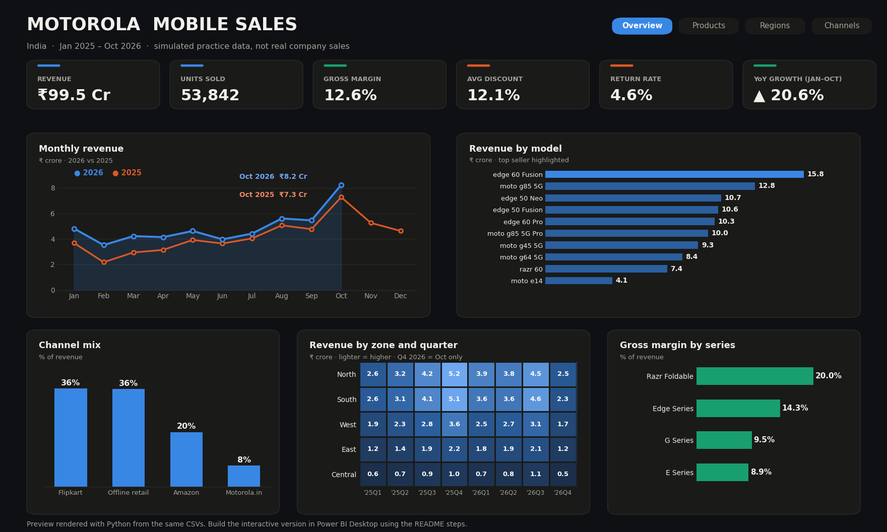

# 📊 Motorola Mobile Sales — Power BI Dashboard

A portfolio-ready **Power BI business intelligence project** exploring simulated smartphone sales across Indian states, product models, sales channels and time. The report is designed around executive KPIs, product performance, regional trends, pricing and returns.



> **Important data disclosure:** this repository uses synthetic practice data generated by `generate_data.py`. It is not Motorola's actual sales, customer, inventory or operational data. Product names and commercial values are illustrative. This independent portfolio project is not affiliated with or endorsed by Motorola.

## Dashboard pages

| Page | Business view | Recommended visuals |
|---|---|---|
| Executive Overview | Revenue, units, gross margin, discount, returns and YoY movement | KPI cards, monthly revenue trend, top models, slicers |
| Product Performance | Model and series contribution | Ranked bar chart, model matrix, ASP vs units scatter |
| Regional Analysis | State and zone performance | Map/bar chart, zone-quarter heatmap, return-rate table |
| Channel & Pricing | Channel mix, discounting and returns | Channel share, discount trend, return-rate comparison, decomposition tree |

## Dataset

The reproducible dataset contains **48,000 simulated order lines**, 10 illustrative smartphone models, 12 Indian states, 4 sales channels and a daily calendar from January 2025 through October 2026.

| File | Description |
|---|---|
| `data/fact_sales.csv` | Order-line fact table |
| `data/dim_product.csv` | Product and model attributes |
| `data/dim_region.csv` | State, zone and hub-city attributes |
| `data/dim_channel.csv` | Sales channel attributes |
| `data/dim_date.csv` | Calendar dimension |

## Build it in Power BI Desktop

1. Download and install Power BI Desktop.
2. In **Home → Get data → Text/CSV**, import all five CSV files from `data/`.
3. In Power Query, confirm date columns are Date type, IDs and quantities are Whole Number, and price/discount/rating columns are numeric. Select **Close & Apply**.
4. Create the four relationships described in [`docs/data-model.md`](docs/data-model.md). Use one-to-many, single-direction relationships from dimensions to `fact_sales`.
5. Mark `dim_date` as the date table using its `date` column. Sort `month_name` by `month_num`.
6. Create a blank table named `_Measures`, then add the measures from [`dax/measures.dax`](dax/measures.dax) individually through **Modeling → New measure**.
7. Build the four report pages using the page plan above. Add slicers for year, series, state/zone and channel.
8. Apply [`docs/motorola-midnight-theme.json`](docs/motorola-midnight-theme.json) from **View → Themes → Browse for themes**.
9. Save the report as `Motorola-Sales-Dashboard.pbix`. Add screenshots of your finished Power BI report to `docs/`.

## Design system

- Canvas: Midnight `#0E1014`
- Visual cards: `#1A1A19`
- Primary blue: `#3987E5`
- Comparison / attention: `#D95926`
- Positive performance: `#199E70`
- Typography: Segoe UI

## Refresh and real-time note

The included CSV dataset is a **static synthetic snapshot**, not a live Motorola feed. You can regenerate it for practice with the commands below and refresh the imported tables in Power BI. For genuine near-real-time reporting, connect Power BI to an authorized operational source (such as a database, API or streaming/event source) and configure the appropriate refresh or streaming architecture. Do not present this sample as live company data.

## Regenerate the sample data and preview

```bash
pip install -r requirements.txt
python generate_data.py
python make_preview.py
```

## Repository structure

```text
Motorola-Sales-PowerBI-Dashboard/
├── data/                         # CSV source tables
├── dax/
│   └── measures.dax              # DAX measures to add in Power BI
├── docs/
│   ├── data-model.md             # Star-schema relationships
│   ├── dashboard-preview.png     # Static preview, not a PBIX report
│   └── motorola-midnight-theme.json
├── generate_data.py
├── make_preview.py
├── requirements.txt
├── .gitignore
└── README.md
```

## Skills demonstrated

Power BI Desktop · Power Query · DAX · dimensional/star-schema modelling · KPI design · data visualization · business analysis · Python · pandas · NumPy · data storytelling.

## Author

**Devendra Rathod** · AI & Data Science · Python & Data Analytics  
GitHub: [@devs901](https://github.com/devs901)
